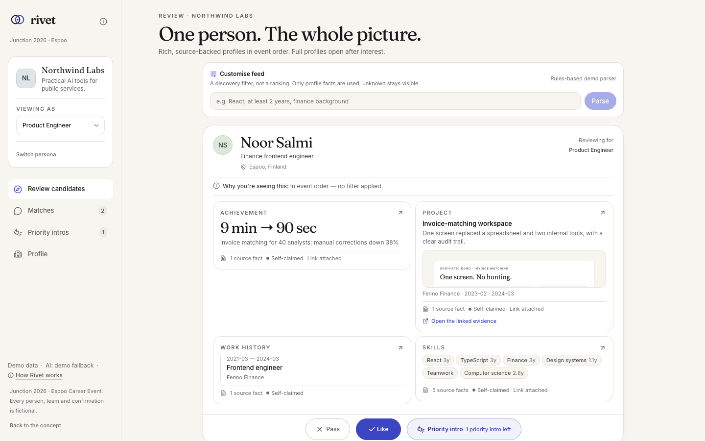
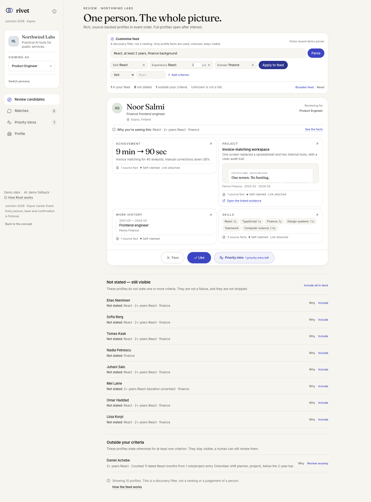
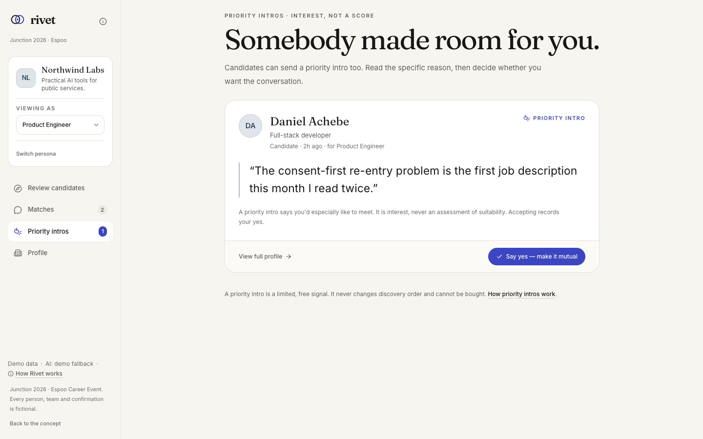
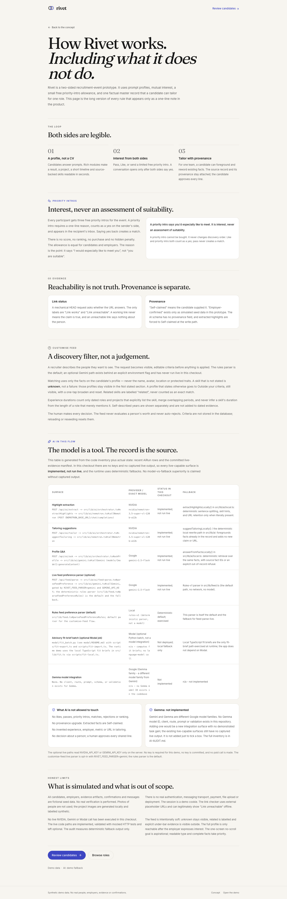

# Rivet — Hiring, both ways

A two-sided recruitment-event prototype for **Junction 2026's "Rethinking Recruitment" track**, built for the **Espoo career event**.

Rivet keeps the one-profile-at-a-time interaction model, but moves the primary demo to the recruiter: a rich, source-backed profile that can be understood in seconds, a visible discovery filter, and a small free interest signal called a **Priority intro**. Candidates still browse roles and can tailor their own record for one team. A match needs both sides.

**Everything in this demo is synthetic.** There are no real people, employers, employment confirmations, evidence artifacts, messages, or contact details. The app never performs real employment verification.

## What changed in this second pass

- **Priority intro** is the limited interest signal. Name, icon and count label live in one module, `src/lib/brand.ts`. Controls are Pass / Like / Priority intro; the count appears once, next to the action.
- **Professional-minimal editorial design**: warm off-white paper, near-black ink, one indigo accent, Fraunces for display headlines only, Inter for everything else, thin dividers, generous whitespace, and one muted status line per surface.
- **Recruiter-first review** is the primary demo path. One candidate per screen, 3–4 rich modules, tap-to-evidence, a gated full profile, and a mobile card-first layout with the feed controls below the card.
- **Customise feed**: natural-language request → visible editable criteria → deterministic matching on profile facts only, with not-stated and outside sections, dated-duration evidence, related-skill labels, protected-characteristic refusal, one-tap broaden and reset.
- **AI audit**: exact model IDs and call sites, no live claim without captured evidence, a fallback-only measured artifact, and an explicit Gemma: not implemented statement.
- **Tailoring fallback fix**: the local rewrite now leads with the action, moves the employer/location out of the opening clause, tightens wording, and says plainly when a claim cannot be meaningfully rewritten.
- **Seed refresh**: a new fictional candidate with a dated finance/React record and a local synthetic project image; rich metadata for portfolio and non-portfolio profiles; 13 candidates and 47 facts in total.

## Quick start — no keys

Requirements: **Node 20.9+** and npm. Tested with Node 20.12.2 and npm 10.5.0. No environment variables are required; no API keys, database server, Docker, or account is needed.

    git clone https://github.com/SimpsonLWH/rethink-recruitment
    cd junction2026
    git checkout recruitment-prototype
    cd recruitment-app
    npm install
    npm run seed
    npm run dev

Open <http://localhost:3000>. The app starts in demo mode with deterministic local AI fallbacks.

- Until the PR is merged, **main does not contain this app**; use the branch checkout above. Review links: [issue #2](https://github.com/SimpsonLWH/rethink-recruitment/issues/2) · [PR #3](https://github.com/SimpsonLWH/rethink-recruitment/pull/3), both assigned to SimpsonLWH.
- npm install runs prisma generate via postinstall.
- npm run seed creates the SQLite database at prisma/dev.db and inserts the synthetic event. It also resets the demo to a clean state.
- The SQLite URL is hardcoded in the Prisma schema as file:./dev.db. There is no DATABASE_URL requirement.
- Optional integrations are key-gated. With no keys, all AI surfaces are labelled **demo fallback** and every flow still works. No live AI call has been executed in this checkout.
- If you have an older dev.db from the first build, delete prisma/dev.db before seeding. The renamed Priority-intro columns require a fresh demo database.

## Primary demo path — recruiter first

1. Open **/enter**. The recruiter tab is the default and Northwind Labs is marked **Start here**.
2. Open **Review candidates**. Noor Salmi's card is the first candidate for the Product Engineer role. Name, headline, achievement stat, project thumbnail, work timeline and source-backed skills are visible, with Pass / Like / Priority intro at the bottom of the first desktop view. On mobile the card comes first and scrolls; the decision bar stays fixed above the bottom nav.
3. Tap the project module. Read the exact source fact, its provenance and its link status. A working link is reachability, not truth.
4. Use **Customise feed** with: "React, at least 2 years, finance background". Three editable criteria appear before applying. Apply them to see **1 in your feed · 8 not stated · 1 outside your criteria**. Open **See the facts** to see the dated duration explanation. Use **Broaden feed** and **Reset** to change the filter.
5. Pass Noor. The next card, **Elias Nieminen**, is a non-portfolio profile: skills, result, responsibility and availability instead of forced imagery.
6. Send Elias a **Priority intro** with a one-line reason. The send button stays disabled until the reason exists; the allowance count updates. After interest, the full profile and Q&A unlock.
7. Open **Priority intros**, match back with the seeded candidate intro, and send a message in the new thread.
8. Open **How Rivet works** from the info icon or the status line. The long-form page contains the feed rules, evidence rules and the generated AI audit table.
9. Switch persona to Aino Vikström, browse the role deck, and open **Tailor a profile**. Generate the local fallback, compare the source fact with the visibly rewritten line, approve it, and open **What they see**.
10. Return to the employer, open Aino's full profile from the seeded match, ask "What does Aino want in a team?", and read the answer with its cited source fact.

Run **npm run seed** again before a fresh walkthrough.

## Product rules

| Rule | How Rivet implements it |
| --- | --- |
| **Prompt profiles, not CVs** | Candidate and employer profiles are built from written prompts and structured facts. There is no CV parser, file upload, or "years of experience" field. |
| **Priority intros** | Each participant gets **3 free** for the event, enforced server-side. A Priority intro needs a one-line reason, counts as a yes on the sender side, appears in the recipient's inbox, and can be matched back. It signals interest, never suitability. It cannot be bought and never changes discovery order. |
| **Mutual matching** | A match row is created only when both sides recorded a yes (Like or Priority intro) for the same role and candidate. Pass never matches. There is no hidden score, penalty, or automated rejection. |
| **Recruiter review** | A rich candidate card presents 3–4 glanceable modules. Tapping a module opens its source facts; the full profile and Q&A only unlock after the employer expresses interest. |
| **Customise feed** | The recruiter's request becomes visible editable criteria before applying. Matching uses only the facts on the candidate's profile. Unknown is not a fail; explicit under-bar evidence is visible outside the criteria. |
| **One factual record, tailored with provenance** | A candidate has one master record. The local fallback or an optional model may select, reorder and reword existing facts for one role. Every suggestion carries source fact IDs; invented links and provenance upgrades are rejected. The candidate approves every line before an employer preview exists. |
| **Evidence has two labels** | Link status is a mechanical reachability check. Provenance is self-claimed or simulated employer-confirmed. Reachability is never presented as truth. |
| **Portfolio is not a prerequisite** | No flow requires a portfolio or evidence link. Non-portfolio profiles render responsibilities, qualifications, availability and results as structured modules; no placeholder imagery is used. |
| **Synthetic data only** | All 13 candidates, 8 employers, 15 roles, 47 facts, 13 matches, 39 messages, 21 seeded Priority intros and 195 fit briefs are fictional. Evidence URLs use example.com placeholders and evidence.invalid for one deliberately unreachable example. Project images are generated locally and labelled synthetic. No photos of people are used. |

## Priority intro

The old signal is gone. The current signal is defined in one module, **src/lib/brand.ts**:

- name: Priority intro
- plural: Priority intros
- icon: the small Spotlight icon
- count label: "2 priority intros left" (with correct singular handling)
- one-line explainer: a Priority intro says you would especially like to meet; it is interest, never an assessment of suitability.

The count is shown once, next to the action. It is not repeated in the sidebar, page headers, inbox or landing stats. The long explainer lives on **How Rivet works**.

## Recruiter review

- **One candidate per screen.** Noor Salmi's review card shows an achievement stat, a project with a locally generated synthetic thumbnail, a compact dated timeline, and source-backed skills.
- **Evidence on tap.** Each module opens the exact source fact, source prompt, provenance and link status. The evidence sheet explicitly says that reaching a URL does not prove the claim.
- **Full profile only after interest.** The review card has no full-profile link. After Like or Priority intro, a "Full profile unlocked" strip links to the full record and Q&A. The server also enforces the gate for the full profile and the ask API.
- **Non-portfolio parity.** Elias Nieminen's card shows skills, result, responsibility and availability. There is no project module and no image placeholder.
- **First view.** At 1440×900 the action bar fits in the first view; the screenshot script warns if it does not. Readable type and complete facts always take priority over forcing a no-scroll fit.
- **Mobile.** The review card comes before the feed controls. The action bar stays fixed above the bottom nav and the card scrolls.

## Customise feed

The feature is intentionally a **discovery filter**, not a ranking or an assessment of a person.

**Flow**

1. The recruiter describes who they want to see, for example: "React, at least 2 years, finance background".
2. The request is parsed by **rules-v1** by default. The result is visible as editable criteria (Skill / Experience / Domain) before anything is applied. Chips can be edited, removed, or added manually.
3. Protected or proxy criteria are refused individually, with one plain line; the rest of the request still applies.
4. The recruiter applies the feed. The summary shows how many candidates are in the feed, how many have unknown criteria, and how many are outside.
5. **Broaden feed** includes all not-stated profiles in the deck; **Reset** clears the criteria. Explicit contradictions stay visible in **Outside your criteria** with a **Review anyway** action.
6. Every card carries a **Why you're seeing this?** line and a details sheet. Each applied criterion shows its matched facts and, for experience, what dated evidence counted.

**Matching semantics**

- **Exact**: an applicant-approved fact states the skill or domain, or dated role/project evidence explicitly lists the skill.
- **Related**: no exact evidence, but a related skill has dated evidence. It is labelled, for example "Vue, 3 years — related to React", and is never counted as an exact match.
- **Not stated / duration uncertain**: the profile does not state the skill, or the mention has no complete dated range. These profiles stay visible and are never silently dropped.
- **States otherwise**: explicit dated evidence below the bar, or an explicitly negative statement. These profiles are visible in Outside your criteria, never auto-rejected.

**Duration rules**

- Only role/project facts with explicit meta.skills and a complete start/end date count toward a skill duration.
- Overlapping periods are merged before summing, so two overlapping React roles do not double-count.
- A role that merely mentions a skill does not donate its full length; if meta.skills does not list the skill, the period is not counted.
- Self-described years are shown separately and are not added to dated months.
- The Why sheet explains what counted, which overlaps were merged, and what was not counted.

**What the feed never does**

- It never uses a candidate's name, avatar, location, bio or tags.
- It never infers from protected characteristics or proxies. A request such as "female React developer" refuses only "female" and keeps the React/experience criteria.
- It never ranks people, scores worth, or auto-rejects. Unknown is not a failure; the human decides.
- It does not persist the criteria in the database. Reloading or reseeding resets the feed.

The required example produces **1 in your feed (Noor Salmi) · 8 not stated · 1 outside (Daniel Achebe)** against the seeded Northwind Product Engineer deck.

## AI integration audit

**Bottom line: no live model run has been recorded in this checkout, no live model output has been captured, and no live integration is claimed.** There are no NVIDIA, Gemini or Modal keys in the environment. No paid API call or paid resource has been used.

| Surface | Provider / exact model | Call path | Status here | Deterministic fallback |
| --- | --- | --- | --- | --- |
| Highlight extraction | NVIDIA / nvidia/nemotron-3.5-super-vl-120b-a12b | POST /api/ai/extract → src/lib/ai/orchestrator.ts → src/lib/ai/nemotron.ts | Implemented; not run live | extractHighlightsLocally() |
| Tailoring suggestions | NVIDIA / nvidia/nemotron-3.5-super-vl-120b-a12b | POST /api/ai/tailor → src/lib/ai/orchestrator.ts → src/lib/ai/nemotron.ts | Implemented; not run live | suggestTailoringLocally() + local rewrite |
| Profile Q&A | Google / gemini-2.5-flash by default (GEMINI_MODEL override) | POST /api/ai/ask → src/lib/ai/orchestrator.ts → src/lib/ai/gemini.ts | Implemented; not run live | answerFromFactsLocally() |
| Customise-feed parse (optional live) | Google / gemini-2.5-flash by default | POST /api/feed/parse → src/lib/ai/feed-parse.ts → src/lib/ai/gemini.ts, only when RIVET_FEED_PARSER=gemini and a locally supplied GEMINI_API_KEY exist | Implemented; not run live | rules-v1 parser |
| Customise-feed parse (default) | Local / rules-v1 | src/lib/feed.ts → parseFeedPreferenceRules | Exercised | This is the default |
| Advisory fit brief | Local TypeScript; optional Modal batch | src/lib/fit.ts; modal/ is not deployed | Local fallback only; Modal not deployed | The runtime never depends on Modal |
| Gemma | Google Gemma family — **not implemented** | None. No model ID, client, route, prompt, schema or validation exists. | Not implemented | Not applicable |

- **Exact model identity:** the only Nemotron model ID in the code is nvidia/nemotron-3.5-super-vl-120b-a12b. Gemini is gemini-2.5-flash by default, overridable with GEMINI_MODEL. The feed rules parser is rules-v1. There is no Gemma integration; Gemini and Gemma are different model families.
- **Gemma tradeoff:** adding a Gemma client would be a new model/prompt/schema/validation/evidence surface. It would not improve any existing surface more than the existing optional paths, which still have no captured live evidence. It is not added just to tick a box.
- **Status labels are derived, not hand-written.** The status layer combines recent AiRun rows with the committed live-evidence manifest. live-with-evidence requires both; otherwise the surface is implemented-not-run and the runtime mode is demo-fallback. The live-evidence manifest is empty in this checkout.
- **Measured fallback artifact:** audit/fallback-samples.json is generated by npm run audit:ai. It contains actual deterministic fallback output for Aino and the Northwind Product Engineer role, including the extraction checks, the tailoring source-vs-output comparison and similarity, the grounded Q&A answer, the required feed-query parse and a protected-characteristic feed example. It is **not model output**, and no model-vs-fallback superiority is claimed.
- **Full audit:** see AI-AUDIT.md, audit/README.md and audit/live/README.md.
- **Optional live paths** read NVIDIA_API_KEY or GEMINI_API_KEY only on the server. No key is required for the demo, none is committed, and the feed parser remains rules-based unless the developer explicitly sets RIVET_FEED_PARSER=gemini. A live status only appears after a real run and a redacted capture; the docs describe the process but do not fake it.

## Tailoring fallback fix

The local fallback previously emitted lines that were nearly identical to the source. It now does a real, visible transformation:

- Source: "At Lumen Retail, I rebuilt the returns flow so a first-time shopper could finish it without contacting support. Completion went from 61% to 84% in six weeks."
- Fallback: "Rebuilt the returns flow so a first-time shopper could finish it without contacting support at Lumen Retail. Completion increased from 61% to 84% in six weeks."

It moves the location out of the opening, leads with the action, tightens the wording, and keeps every name, number and source fact. The rationale describes the actual change. The measured fallback similarity is in audit/fallback-samples.json; the line is below the near-copy threshold. If no meaningful change is possible for a claim, the fallback omits it and records a plain draft note ("3 claims had no meaningful rewrite and were left out; they remain in the master record") instead of emitting a near-copy. The candidate still approves every line; provenance stays attached.

## Design direction

- Paper #F7F5F0, surface #FFFFFF, ink #171717, one indigo accent #3D46C2. Red is not a theme colour.
- Fraunces Variable for display headlines only; Inter for claims, labels, buttons and all body text. No text below 11px.
- Thin dividers, generous whitespace, one restrained primary action, no stacked badge clusters and no decorative gradients or blobs.
- One muted status line per surface: "Demo data · AI: demo fallback". No repeated AI chips, synthetic badges or evidence legends.
- The long explanations live on **/how-it-works**, reachable from the info icon and the status line. /about-ai redirects there.

## Seed data and synthetic assets

- 13 fictional candidates, 8 employers, 15 roles, 47 facts, 13 seeded matches, 39 messages, 21 seeded Priority intros and 195 local fit briefs.
- Noor Salmi is the new fictional finance frontend candidate. Her dated 2021–2024 role and 2023–2024 project exercise the experience-overlap and finance-domain paths; the project image is a locally generated SVG.
- Nadia Petrescu has a dated Vue role, exercised as a related-skill match. Mei Laine has an undated React QA fact, exercised as duration-uncertain. Daniel Achebe has dated React project evidence below the two-year bar, exercised as Outside your criteria.
- Portfolio images in public/demo/ are abstract SVGs generated for this prototype and visibly labelled SYNTHETIC DEMO. No external media, real logos or photos are used.
- Every candidate has a seeded match and an inbound Priority intro; every employer has an inbound intro. The employer-sent intro distribution keeps room to send one during the demo.

## Architecture

    src/app/                     routes: landing, enter, review/discover, priority intros, profile, candidates, matches, tailor, how-it-works
    src/app/api/                 decisions, evidence checks, employer Q&A, extract, tailor, feed parse, AI status
    src/components/app/          app shell, role switcher
    src/components/brand/        logo, avatar, source labels, AI status line, page header
    src/components/discovery/    role deck, decision actions, priority-intro dialog, match dialog
    src/components/review/       employer review card, rich modules, evidence sheet, feed panel, why sheet, employer discovery
    src/components/priority-intros/  inbox list
    src/lib/                     brand constants, feed parser/matcher, profile modules, evidence, fit, session, repository
    src/lib/ai/                  provider clients, prompts, validation, deterministic fallbacks, feed parse service, audit inventory/status
    prisma/                      SQLite schema, seed and synthetic seed data
    scripts/                     smoke, screenshots, fit helpers, fallback audit
    audit/                       actual fallback evidence; future redacted live-capture rules
    public/demo/                 locally generated synthetic project illustrations
    modal/                       optional, undeployed advisory fit-brief batch

Data-model changes in this pass: Candidate/Employer priorityIntroAllowance; Fact.metaJson for structured project/role/skill metadata; TailoringDraft.note for the honest no-rewrite note. The old signal name is removed from the action values, routes and seed.

## Verification

Run from recruitment-app/ with the app dependencies installed:

    npm run lint
    npm run typecheck
    npm test
    npm run build
    python3 -m unittest discover -s modal -p 'test_*.py'
    npm run seed
    npm run dev            # separate terminal
    npm run smoke
    npm run screenshots
    npm run audit:ai
    npm run seed           # leave a clean demo

What each covers:

- **Unit tests** exercise the brand constants, mutual matching/Priority-intro budget, feed parser and matcher (including overlap merge, related, unknown, under-bar, protected refusal and no name/location inference), profile module builder, evidence labels, fit briefs, local AI fallbacks, validation, HTTP retry and AI status derivation.
- **Smoke** covers: candidate pass; required-reason Priority intro and the allowance count; evidence link status; grounded highlight extraction and add; Priority-intro inbox match-back and message; tailoring fallback visibly changing a line with source trace; human approval and employer preview; rich portfolio review and evidence sheet; feed parse, editable criteria, apply, why, broaden and reset; rich non-portfolio review; employer Priority intro with required reason and full-profile unlock; employer inbox match-back and message; employer Q&A with citations.
- **Screenshots** are captured desktop and mobile, then opened and inspected. The committed files in screenshots/ are the verified-final versions.
- **AI fallback audit** writes audit/fallback-samples.json and never calls a model. It is actual fallback evidence, not model output.

The commands above pass in this checkout. The browser smoke and screenshot script mutate demo state; run npm run seed afterwards.

## Screenshot highlights

| | |
| --- | --- |
|  |  |
| Recruiter review, first view | Feed applied with not-stated and outside sections |
|  |  |
| Priority intro inbox | The single long-form safeguard and AI audit page |

The full inventory is in [screenshots/README.md](screenshots/README.md).

## What is not being claimed

- No live Nemotron, Gemini or feed-parser request has been made in this checkout. No live output exists.
- No model-vs-fallback superiority is claimed. The only measured AI-adjacent output is deterministic fallback output.
- Gemma is not implemented. Modal is not deployed. No paid resource has been used.
- No prize, score, placement, or eligibility is promised or predicted.
- No real candidate, employer, verification, authentication, payment, upload, or messaging transport exists. The session is a demo cookie. The link checker uses external placeholder URLs and can legitimately show "Link unreachable" offline.
- The one-screen no-scroll goal is aspirational. Readable type, complete facts and accessible controls take priority; the card may scroll.
- The feed is a soft discovery filter by design. Unknowns stay visible; explicit contradictions stay visible in Outside your criteria; nothing is auto-rejected.

## Repository and review links

- Branch: recruitment-prototype
- Issue: [issue #2](https://github.com/SimpsonLWH/rethink-recruitment/issues/2)
- Pull request: [PR #3](https://github.com/SimpsonLWH/rethink-recruitment/pull/3)
- Only recruitment-app/ is changed by this work. Nothing is merged, deployed or made public.
