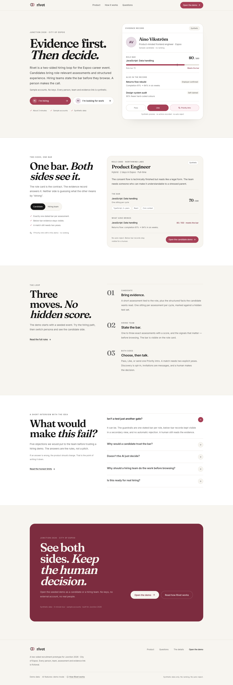

# Rivet — Hiring, both ways

A two-sided recruitment-event prototype for **Junction 2026's "Rethinking Recruitment" track**, built for the **Espoo career event**.

Rivet applies the Hinge-style interaction model to hiring: richer prompt profiles, interest from both candidates and employers, mutual matches only, a small free rose allowance, and one factual master record that can be tailored — with explicit human approval — for a specific company.

**Everything in this demo is synthetic.** There are no real people, employers, employment confirmations, evidence artifacts, messages, or contact details. The app never performs real employment verification.



## The product in seven rules

| Rule | How Rivet implements it |
| --- | --- |
| **Prompt profiles, not CVs** | Candidate and employer profiles are built from three or more written prompts. There is no CV parser, file upload, or "years of experience" field. |
| **Evidence links are honest by construction** | Each claim can carry an evidence link. The app tracks **link status** (mechanical HEAD check — "Link works" / "Link unreachable") and **provenance** (self-claimed / simulated employer-confirmed) as two separate labels. Reachability is never presented as truth. |
| **Mutual matching** | A match row is created only when both sides recorded a yes (like or rose) for the same role and candidate. Pass never matches. Discovery order is the seeded event order; there is no hidden score, penalty, or automated rejection. |
| **Free, equal roses** | Each fictional participant gets 3 free roses for the event, enforced server-side. A rose needs a one-line reason, counts as a yes, and has no effect on ranking. Roses cannot be bought. |
| **One factual record, per-company tailoring** | A candidate has one master record. AI (or local fallback) may select, reorder, and reword existing facts for one role. Every suggestion must carry source fact IDs; unknown IDs, invented links, and provenance changes are rejected. The candidate reviews, edits, rejects, and approves before an employer preview exists. |
| **Portfolio is not a prerequisite** | No flow checks for evidence links or work samples. Non-technical profiles and roles work with prompt facts alone; every seeded role is marked as not requiring a portfolio. |
| **Synthetic data only** | All 12 candidates, 8 employers, 15 roles, 40 facts, 12 matches, 20 roses, 36 messages, and 180 fit briefs are fictional seed data. Evidence URLs use `example.com` placeholders and `evidence.invalid` for one deliberately unreachable example. No photos of people are used. |

## Quick start — exactly this, with no keys

Requirements: **Node 20.9+** and npm. Tested with Node 20.12.2 and npm 10.5.0. No environment variables are required; no API keys, database server, Docker, or account is needed.

```bash
git clone https://github.com/SimpsonLWH/rethink-recruitment
cd junction2026
git checkout recruitment-prototype
cd recruitment-app
npm install
npm run seed
npm run dev
```

Open <http://localhost:3000>. The app starts in demo mode with deterministic local AI fallbacks.

- Until the PR is merged, **main does not contain this app**; use the branch checkout above. Review links: [issue #2](https://github.com/SimpsonLWH/rethink-recruitment/issues/2) · [PR #3](https://github.com/SimpsonLWH/rethink-recruitment/pull/3), both assigned to SimpsonLWH.
- <code>npm install</code> runs <code>prisma generate</code> via postinstall.
- <code>npm run seed</code> creates the SQLite database at <code>prisma/dev.db</code> and inserts the synthetic event.
- <code>npm run reseed</code> is the same command and resets the demo to a clean state. Run it before a judge walkthrough if prior interactions were made.
- The SQLite URL is hardcoded in the Prisma schema as <code>file:./dev.db</code>. There is no <code>DATABASE_URL</code> requirement.
- Optional integrations are key-gated. With no keys, all AI surfaces are clearly labelled **demo fallback** and every flow still works.
- Optional ports: <code>npm run dev -- -p 3001</code>. Start with <code>PORT=3001</code> if you use a different port.

### Optional environment

Copy <code>.env.example</code> to <code>.env.local</code> only if you are authorised to use a key. No value is required for the demo.

| Variable | Required? | Purpose |
| --- | --- | --- |
| <code>NVIDIA_API_KEY</code> | No | Live Nemotron highlight extraction and tailoring suggestions. |
| <code>GEMINI_API_KEY</code> | No | Live "Ask this profile" Q&A. |
| <code>GEMINI_MODEL</code> | No | Optional Gemini model override; defaults to <code>gemini-2.5-flash</code>. |
| <code>MODAL_TOKEN_ID</code> / <code>MODAL_TOKEN_SECRET</code> | No | Optional Modal fit-brief batch. Not used by the app at runtime. |

## Three-minute judge demo

Run <code>npm run seed</code>, then <code>npm run dev</code>. Open <http://localhost:3000/enter>.

1. **Landing → candidate.** Open the demo, choose **Aino Vikström** (recommended). The demo has no passwords; this is a seeded persona selection.
2. **Discover.** Point out the "Event order — not ranked" label, the role prompt, and the evidence badges. Pass a card, send a rose with a one-line reason (the allowance is visible), and like a role.
3. **Rose inbox.** Open **Roses**. Common Ground sent Aino a specific reason for a Frontend Engineer role. Click **Say yes — make it mutual**, then send a message in the new thread.
4. **The record.** Open **Profile**. Show the link-status badge automatically becoming "Link works" (or "Link unreachable" if offline). Open the **AI highlight studio**, extract highlights from the prefilled example, and add one. It is saved as **Self-claimed**; AI cannot upgrade provenance.
5. **Tailoring.** Open **Tailor a profile** → Product Engineer at Northwind Labs. Generate suggestions. Each card shows the exact source fact. Approve, edit, or reject lines; approve at least one and open **What they see**. Only approved lines appear, with the source provenance and approval audit.
6. **The other side.** Switch persona (sidebar) to **Northwind Labs** (recommended employer) and use the **Product Engineer** active role. Browse candidates, open Aino's full profile, ask the record a question, and read the sourced answer. The rose inbox contains a candidate's rose and can be matched back.
7. **Honesty.** Open **About the AI** from the sidebar. It shows the exact model string, the current demo/live status, and what the AI is forbidden to do.

## What works, right now, with zero keys

- Landing page, persona picker, candidate and employer demo sessions.
- Prompt-based discovery decks with pass/like/rose buttons, drag polish, keyboard shortcuts, live rose allowance, and mutual-match celebration.
- Mutual matches only; a persisted conversation thread; send and read messages from either persona.
- Rose inbox with reasons and match-back; server-enforced 3-rose budget for both sides.
- Candidate master record with optional evidence links, mechanical link checking, separate link-status/provenance badges, and simulated employer confirmation labels.
- AI highlight studio with deterministic local extraction and source-quote validation; accepted highlights are forced to Self-claimed.
- Tailoring generate → source-fact review → edit/reject/approve → approved employer preview, all persisted.
- Advisory fit brief after mutual matches, generated from local deterministic logic.
- Employer profile Q&A with sourced answers and out-of-record refusals.
- About-the-AI page, empty states, loading states, error boundary, responsive mobile layout.
- Unit tests, lint, typecheck, production build, browser smoke, and screenshots.

### Honest limits / stubs

- **Live AI calls are implemented but were not executed**: no <code>NVIDIA_API_KEY</code> or <code>GEMINI_API_KEY</code> was present in the build environment. The keyless fallback is the path exercised by every test and screenshot. The schemas/retry/validation paths are unit-tested with mocked HTTP, not against the live hosted endpoints.
- **Modal was not deployed**: no Modal tokens were present and no account was created. The Python batch and pure logic tests are shipped; the local TypeScript batch is what generated the seeded fit briefs.
- **No real authentication.** The session is a validated demo cookie. Do not treat it as a security boundary.
- **No real messaging infrastructure.** Messages persist in SQLite; there is no realtime transport, delivery, read receipts, or encryption. This is explicitly out of scope.
- **No payments, uploads, photo/video, automated acceptance or rejection.**
- **The employer-side view of a tailored profile beyond the candidate-controlled preview is not wired** as a separate production recipient screen; the preview demonstrates the approved result and no unapproved draft is exposed anywhere.
- **Link checks use synthetic placeholder URLs** that are intentionally not proof of anything. If the machine is offline, the UI honestly shows "Link unreachable".
- **No public deployment.** The app is local and the repository stays private.

## Integration and bounty status (honest)

No prize is promised, predicted, or claimed. The table below states exactly what exists in this checkout.

| Integration / challenge target | Status | What is genuinely implemented | What is stubbed or untested | Where a judge sees it |
| --- | --- | --- | --- | --- |
| **NVIDIA Nemotron 3.5 Super VL** (<code>nvidia/nemotron-3.5-super-vl-120b-a12b</code>) | Implemented, **untested live, needs key**; fallback exercised | OpenAI-compatible client at <code>https://integrate.api.nvidia.com/v1</code>; strict JSON prompts; Zod validation; source-quote/source-ID checks; one repair attempt; 3-attempt backoff with jitter; 24h DB cache; provenance stripped; deterministic fallback with honest engine labels | The hosted endpoint was never called because no key existed. No claim is made that it works live. | AI highlight studio; tailoring review; About the AI; engine/AI status chips |
| **Modal** | Implemented, **not deployed, needs tokens**; local fallback exercised | CPU-only Python batch over the full synthetic dataset; profile/fit logic; validation; local unit tests; repository import/export scripts; exact commands in <code>modal/README.md</code> | Not run remotely; never deployed; no spend. Seeded fit briefs use <code>generatedBy="local-fallback"</code>. | Advisory fit brief after a match; About the AI status table |
| **Google Gemini** | Implemented, **untested live, needs key**; fallback exercised | Employer-side "Ask this profile" Q&A; record-only prompt; JSON schema; source ID validation; same cache/retry discipline; deterministic grounded retrieval fallback | No <code>GEMINI_API_KEY</code> present; live path untested. | Candidate profile → Ask this profile |
| **Other challenges** | Skipped | Nothing added solely for a logo | Reasons below | README / About the AI |

Skipped, with reasons: Aiven (no hosted database; local SQLite is the honest choice), Context.dev (no key and no genuine core flow), CRACI (no CI and no authorization), Cloudinary (no real media scope; generic image delivery would not qualify; **the [Cloudinary survey](https://cld.media/hackathon-survey) was not attempted because the integration was skipped**), ElevenLabs (not nearly free to add without distracting from the core), Verda (nothing deployed there), Entire (no session-sharing approval), Codex (Codex was **not** used to build this; only DeepSeek was; no Codex claim), and the hardware/Solana/Oxylabs challenges (not applicable to this product). MongoDB Atlas, Tiger Data, and Vultr were not added as bolt-ons.

## Architecture

### Stack

- Next.js **15.5.29** (App Router) + React **19.2.9** + TypeScript strict.
- Tailwind CSS **3.4.19** + shadcn/ui-style primitives vendored into <code>src/components/ui</code>; Radix Dialog, Sonner, Lucide, CVA, clsx, tailwind-merge.
- Prisma **6.19.3** + SQLite at <code>prisma/dev.db</code>; one event-scoped schema.
- Framer Motion 12 for card motion and reduced-motion-aware transitions.
- Fonts: Fraunces Variable and Inter Variable via local <code>@fontsource-variable</code> packages; no runtime font requests.
- Tests: Vitest for TypeScript logic; Python standard-library <code>unittest</code> for the Modal logic.
- Screenshot/smoke driver: <code>playwright-core</code> with system Chrome. It does not download a browser.

### Source layout

```
src/app/                   routes + API handlers
src/components/            app shell, brand, discovery, profile, matches, tailoring, roses, ui
src/lib/repo/              the single repository interface + Prisma implementation
src/lib/ai/                NVIDIA/Gemini clients, prompts, schemas, validation, fallbacks, orchestration
src/lib/                   session, matching, roses, evidence, fit, API helpers
prisma/                    schema + deterministic synthetic seed data
modal/                     optional Python batch + pure logic tests + README
scripts/                   fit export/import/local, screenshots, smoke
screenshots/               committed verification images
```

Every runtime read/write goes through the **<code>RecruitmentRepository</code>** interface in <code>src/lib/repo/</code>. The Prisma client is only instantiated there (and in the seed/initialization and batch scripts). Server components, route handlers, and scripts use the repository.

The UI is responsive and mobile-first. On narrow screens the decision bar floats above the bottom tab bar rather than being buried below the card. The desktop shell uses a persistent left rail and a right context panel. All AI calls are server-only.

### Data model (one event)

- <code>Event</code>, <code>Candidate</code>, <code>Employer</code>, <code>Role</code>, <code>EmployerPrompt</code>, <code>Fact</code>.
- <code>Decision</code> (actor type + role + candidate + like/pass/rose + reason; unique per actor/pair).
- <code>Match</code> + <code>Message</code>; matches exist only after mutual yes.
- <code>TailoringDraft</code> + <code>TailoringItem</code> (source fact IDs, status, approvedAt).
- <code>LinkCheck</code> (fact-level mechanical status and timestamp).
- <code>AiRun</code> + <code>AiCache</code>; <code>FitSummary</code>.
- Enums are stored as string constants for portability; UI mapping is explicit.

### Seed shape and demo guarantees

- 12 fictional candidates: 7 technical and 5 non-technical. All have 3+ prompt facts; some have no evidence links at all.
- 8 fictional employers, 3 prompts each, **15 roles** total, **1–3 roles per employer**.
- Every persona has at least one seeded mutual match, a 3–4 message thread, and one inbound rose with a specific reason.
- The seed includes 20 roses (one inbound to each candidate and each employer), 12 matches, 36 messages, 40 facts, and 180 local fit briefs.
- Seeded roses are distributed so no participant starts with all 3 spent; both candidate and employer demos can still send a rose. The total budget is 3 for each participant for the event.
- One candidate fact is employer-confirmed by Lumen Retail and another by Metsä Health; the UI labels these as **simulated demo data**, never as real verification.
- All IDs are stable strings for deep links; <code>npm run seed</code> resets the entire demo.

## Evidence, provenance, and tailoring guardrails

- **Link checker:** POST <code>/api/evidence/[factId]/check</code> loads only a fact ID from the session-scoped repo, performs a HEAD with a 5s timeout, follows redirects, blocks private/local hosts, and caches the result for 24h. The UI has only **"Link works"** / **"Link unreachable"** status labels; "checked 1m ago" is separate metadata, not a truth claim. A recheck button is available.
- **Provenance:** exactly two values. The AI schema has **no provenance field**, and the repository's <code>addFact</code> writes <code>SELF_CLAIMED</code> unconditionally. <code>EMPLOYER_CONFIRMED</code> exists only in seed data and is visibly labelled simulated.
- **Tailoring:** AI output must cite source fact IDs that exist in the candidate's record. Unknown IDs, URLs not present in source facts, malformed JSON, or missing source IDs fail validation and fall back locally. The candidate's approval is a database event; approved previews render only approved items and only source-derived provenance. No unapproved draft is exposed in the preview.
- **Matching:** mutual-only database event. There is no ranking score anywhere in discovery; the fit brief is a post-match advisory text panel, not a decision engine or ordering input. It is explicitly labelled "Not a score."
- **Non-portfolio path:** no UI or server logic requires an evidence link or portfolio to browse, match, message, extract, or tailor.

## AI design (real paths + fallbacks)

### NVIDIA Nemotron

- Model: <code>nvidia/nemotron-3.5-super-vl-120b-a12b</code>; base URL <code>https://integrate.api.nvidia.com/v1</code>; OpenAI-compatible chat completions.
- Extraction: strict JSON <code>{highlights:[{skill, claim, evidenceUrl|null, sourceQuote}]}</code>. The server checks the source quote is in the input, strips any URL not literally in the input, and never accepts provenance. Accepted facts are self-claimed.
- Tailoring: strict JSON <code>{suggestions:[{kind, sourceFactIds, proposedText, rationale}]}</code>. Source IDs are checked against the master record; URLs are checked against source facts; the UI shows source facts next to every suggestion; approval is human-only.
- Reliability: three attempts on 429/5xx/network errors with exponential backoff and full jitter, capped Retry-After; one repair attempt for malformed output; SHA-256 response caching in SQLite for 24h; tiny prompts; deterministic fallback on missing key, failure, or invalid output. The server logs a one-line warning and records the engine in <code>AiRun</code>.
- Indicator: the sidebar/status chip shows **AI: live (Nemotron)** only after a successful live call; otherwise **AI: demo fallback**. The About page shows the exact model and last runs.

### Gemini (optional)

Employer-side **Ask this profile** on <code>/candidates/[id]</code>. The server passes only profile facts, validates returned source IDs, and refuses answers outside the record. No live key was present, so the tested path is the deterministic local retrieval fallback, which cites the same facts.

### Modal (optional)

The Python batch in <code>modal/</code> consumes an exported synthetic dataset and computes fit themes, evidence coverage, and human questions. It is not a thin endpoint and not deployed. It writes a JSON artifact imported through the TypeScript repository after source-ID validation. Local fallback is used for the running demo; the UI labels the source.

## Verification

Run from <code>recruitment-app/</code>:

```bash
npm run lint
npm run typecheck
npm test
npm run build
python3 -m unittest discover -s modal -p 'test_*.py'
```

With the dev server running:

```bash
npm run smoke        # keyless browser smoke; mutates state
npm run screenshots  # keyless Playwright visual pass; mutates state
```

- Unit tests cover matching/mutual-only rules, rose budgets, evidence label separation, fit-brief transparency, deterministic extraction/tailoring/ask fallbacks, AI schema/source validation, and HTTP retry behavior.
- The browser smoke test exercises pass, rose, match-back, messaging, evidence status, highlight extraction/add, tailoring review/approval/preview, employer decisions, and employer match-back.
- The screenshot run exercises the desktop and mobile layouts and writes committed images to <code>screenshots/</code>. Both scripts assume a seeded server; reseed after either.
- Current build results: lint and typecheck pass; 21 Vitest tests pass; production build passes; the keyless browser smoke passes; Python fit logic tests pass.
- Fresh-clone verification passed from the pushed branch: install → seed → build, then served with no env; landing, entry, About AI, and the AI status endpoint returned 200, with no keys and demo fallback active.

Visual truth: screenshots are generated from the running app with no keys. Some screenshots include demo AI fallback labels, which is the intended honest state in this build.

## Screenshots

| Screen | File |
| --- | --- |
| Landing | <code>screenshots/landing-desktop.png</code> |
| Persona picker | <code>screenshots/enter-candidate.png</code> |
| Candidate discovery | <code>screenshots/discover-candidate.png</code> |
| Candidate master record + evidence | <code>screenshots/profile-candidate.png</code> |
| Mutual match conversation | <code>screenshots/match-thread.png</code> |
| Rose inbox | <code>screenshots/rose-inbox.png</code> |
| Tailoring review with source trace | <code>screenshots/tailor-review.png</code> |
| Approved employer preview | <code>screenshots/tailor-preview.png</code> |
| Employer discovery | <code>screenshots/discover-employer.png</code> |
| Employer asks a profile a question | <code>screenshots/candidate-ask.png</code> |
| About the AI | <code>screenshots/about-ai.png</code> |
| Mobile landing / discovery | <code>screenshots/landing-mobile.png</code>, <code>screenshots/discover-candidate-mobile.png</code> |

## Out of scope / not built

Real authentication, real messaging infrastructure, payments, file/photo/video upload, automated acceptance or rejection, and public deployment are intentionally not built. The demo is event-scoped and synthetic. No API key, deploy credential, or repository visibility change is required to run it locally.

## Documentation

- [DECISIONS.md](./DECISIONS.md) — judgment calls, tradeoffs, and what was considered and skipped.
- [HANDOFF.md](./HANDOFF.md) — morning checklist, test/visual status, blockers, and next steps.
- [SUBMISSION-NOTES.md](./SUBMISSION-NOTES.md) — **DRAFT** NVIDIA submission notes; only implemented claims.
- [modal/README.md](./modal/README.md) — Modal status and exact commands, if authorized.
- [screenshots/README.md](./screenshots/README.md) — screenshot inventory and regeneration instructions.
